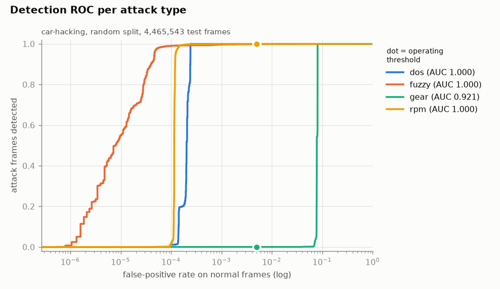
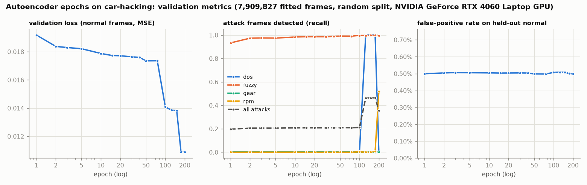
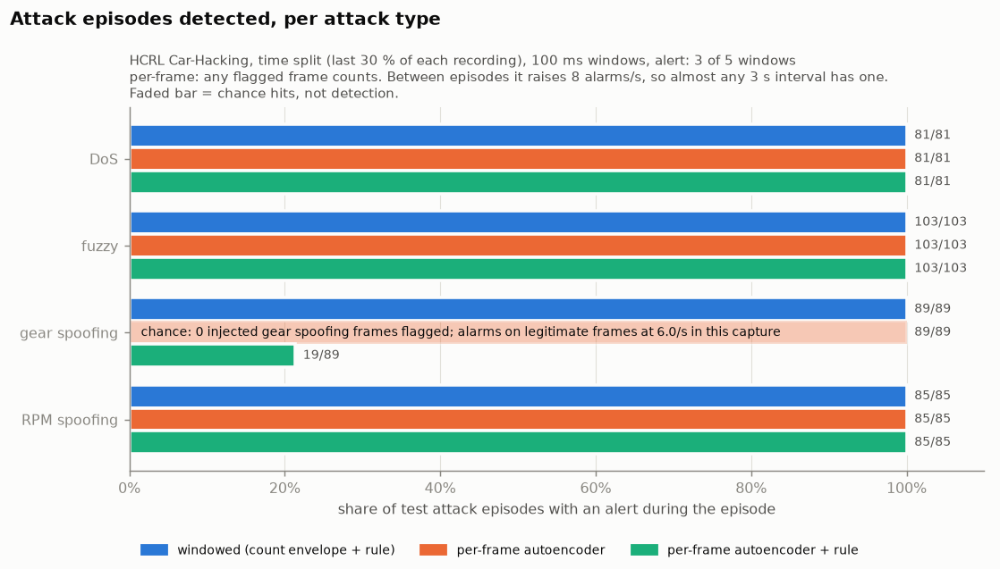
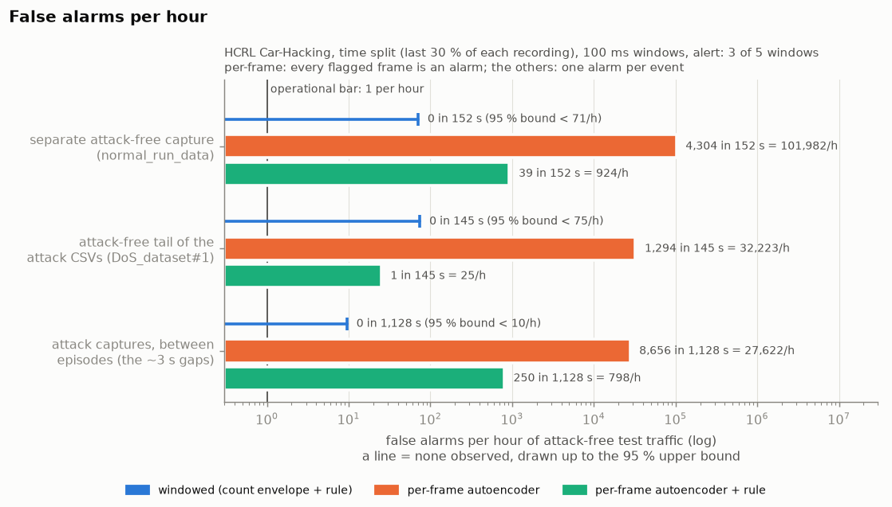
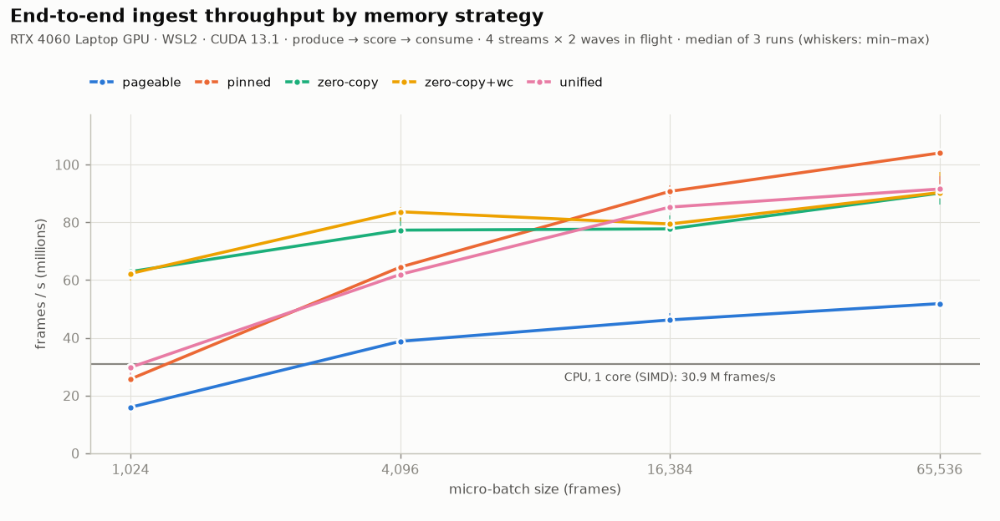

# GuardCAN

**GPU-accelerated AI intrusion detection for in-vehicle networks (CAN / CAN-FD), with a fleet V-SOC console.**

A portfolio proof-of-concept that demonstrates both **applied AI** (anomaly detection on automotive network traffic) and **HPC/systems** (a line-rate GPU inference engine), built on NVIDIA developer tools and mapped to the regulations that make in-vehicle intrusion detection a near-future requirement (UN R155/R156, ISO/SAE 21434, ISO 26262, ISO 42001).

> **Status: proof-of-concept.** Not deployed in real vehicles. The CAN-layer detector has now been evaluated **offline on the public HCRL Car-Hacking dataset** (recorded CAN traffic with injected attacks; [results below](#results-on-the-hcrl-car-hacking-dataset)), including its weaknesses, both per frame and as [windowed, event-level detection](#windowed-event-level-detection-hcrl-time-split). The synthetic Car-Hacking-format set (`data/make_synthetic.py`) is kept as a smoke test only. The HPC-engine timings replay synthetic input (timing doesn't depend on the data). The service-oriented (SOME/IP) layer and the fleet scale will be represented with synthetic data, labelled as such. All reported numbers are POC measurements on one machine.

---

## Repository layout

The CAN detection core (Week 1), the HPC engine (Week 2), and their docs:

```
guardcan/
├── data/
│   ├── README.md          # how to get the real HCRL Car-Hacking dataset + what its files contain
│   └── make_synthetic.py  # generates a small Car-Hacking-format dataset so you can run NOW
├── ingest/
│   ├── can_loader.py      # robust parser for the (ragged) Car-Hacking CSV format; dedup, per-recording
│   ├── features.py        # per-message features: ID bits, payload bytes, timing
│   └── windows.py         # 100 ms windows: frames per CAN ID per window
├── model/
│   ├── autoencoder.py     # unsupervised AE (PyTorch on GPU; scikit-learn fallback)
│   ├── train_autoencoder.py
│   ├── train_classifier.py# supervised attack-type classifier
│   ├── epoch_study.py     # autoencoder validation metrics vs training epochs
│   ├── eval.py            # per-class precision/recall/F1, confusion matrix, ROC-AUC, per-attack recall
│   ├── windowed.py        # windowed detector: per-ID count envelope + K-of-N alert rule, episode scoring
│   ├── train_windowed.py  # fit the envelope on attack-free training windows, check it on validation
│   ├── eval_windowed.py   # event-level evaluation (episodes, latency, false alarms/h) vs the per-frame baseline
│   └── plot_windowed.py   # charts for bench/hcrl/windowed/
├── engine/                # Week 2: CUDA inference engine + benchmarks (see below)
├── bench/hcrl/            # results on the HCRL Car-Hacking dataset (metrics, ROC, confusion, epoch study)
│   └── windowed/          # windowed, event-level detection (metrics.json, charts, cross_day/)
├── bench/hpc/             # Week 2: measured results, charts, Nsight Systems profile
├── docs/                  # architecture, compliance mapping, threat model, hpc-engine, windowed-detection
├── run_week1.py           # one command: synth data -> features -> train -> eval
└── run_week2.py           # one command: export weights -> build -> verify -> benchmark
```

## Run it in 30 seconds (no dataset needed)

```bash
pip install -r requirements.txt
python run_week1.py          # generates synthetic data, trains, evaluates, prints an F1 table
```

With PyTorch installed, the autoencoder trains with it (on the GPU if one is available). Without PyTorch, the
scikit-learn fallback runs on the CPU. Either way the autoencoder trains for 200 epochs; scikit-learn stops earlier
once its loss converges. Measured end to end: 30 s on an RTX 4060 laptop with PyTorch. The point is to confirm the
pipeline before you download anything or open Colab.

## Run it on the real dataset (local GPU or Colab)

1. Get the HCRL Car-Hacking dataset — see `data/README.md` (it also lists what the files contain, quirks included).
2. Put the files in `data/car-hacking/`.
3. Train + evaluate:

```bash
# unsupervised anomaly detector (learns "normal", flags deviations)
python -m model.train_autoencoder --data data/car-hacking --backend torch --out models/

# supervised attack-type classifier (DoS / fuzzy / gear-spoof / rpm-spoof)
python -m model.train_classifier  --data data/car-hacking --out models/

# evaluate both; writes bench/hcrl/metrics.json, roc.png, confusion.png
python -m model.eval --data data/car-hacking --models models/ --out bench/hcrl

# harder second test set: the last 30 % of every recording instead of random rows
python -m model.train_autoencoder --data data/car-hacking --backend torch --split time --out models/hcrl-time
python -m model.train_classifier  --data data/car-hacking --split time --out models/hcrl-time
python -m model.eval --data data/car-hacking --models models/hcrl-time --out bench/hcrl/time_split

# validation metrics vs epochs (bench/hcrl/epoch_study.json + .png; ~1.5 h on the laptop GPU)
python -m model.epoch_study --data data/car-hacking --epochs 200

# windowed, event-level detection on the time split (~2 min each; needs the time-split models above)
python -m model.train_windowed --data data/car-hacking --out models/hcrl-time
python -m model.eval_windowed  --data data/car-hacking --models models/hcrl-time --out bench/hcrl/windowed
```

With PyTorch, the autoencoder saves its model and optimiser to `<out>/ae_checkpoint.pt` every 20 epochs
(`--checkpoint-every`). If a run is killed, the same command with `--resume` continues from the last checkpoint and
ends with the same weights as an uninterrupted run (checked on the same GPU: identical to the bit).

Locally or on Colab, `--backend torch` uses the GPU automatically when one is available
(`torch.cuda.is_available()`).

Measured on the RTX 4060 laptop: loading and featurising the full set takes ~95 s per script, and every step
peaks at 3.9–4.4 GiB of host memory. That is well below a free Colab instance's RAM, though this hasn't been run on
Colab. The autoencoder trains for 200 epochs by default, which took 93 minutes on HCRL. The epoch study found no
smaller number that gives stable results; see [How many epochs?](#how-many-epochs) below.

## The two models (and why two)

- **Autoencoder (unsupervised).** Trained only on *normal* traffic; the reconstruction error is the anomaly score. The intent: flag attacks it was never trained on (novel / zero-day). On HCRL it does that for fuzzing, but not reliably for spoofing or DoS (see below).
- **Classifier (supervised).** The dataset is labelled, so a multi-class model names the attack type for the SOC console's class breakdown and the per-class F1 table.

## Results on the HCRL Car-Hacking dataset

An offline evaluation on the public [HCRL Car-Hacking dataset](https://ocslab.hksecurity.net/Datasets/car-hacking-dataset):
recorded CAN traffic with injected DoS, fuzzing, gear-spoofing and RPM-spoofing attacks, labelled per frame. This is
one public dataset evaluated after the fact, not a deployment. Everything was measured on one machine
(RTX 4060 Laptop GPU under WSL2, i7-14650HX). Metrics, charts and the epoch study are in [`bench/hcrl/`](bench/hcrl/).

**Data preparation** (details in [`data/README.md`](data/README.md)). The five files hold 17,558,346 rows. The
four attack CSVs all end with the same 891,068-frame attack-free block. The loader keeps one copy, which leaves
14,885,142 frames (12,553,625 normal, 2,331,517 injected). The timing features are computed per recording.

**Two test sets.**
- *Random split* (primary): 30 % of frames, stratified by label, seed 42 (4,465,543 test frames). Test frames sit
  between training frames from the same moment of the same capture. Every DoS, gear and RPM test frame has the same
  ID and payload as thousands of training frames. This is the optimistic number.
- *Time split* (harder): the last 30 % of every recording is the test set (4,465,546 frames), so the models never
  see the test period of any capture. Each attack capture still has 81–103 of its 300 injection bursts in that period.

### Detection (autoencoder, unsupervised)

PyTorch on the GPU, 200 epochs. The threshold is the 99.5th percentile of the error on normal training frames.

| test set | test frames | precision | recall | F1 | ROC-AUC | false positives on normal frames |
|---|---:|---:|---:|---:|---:|---:|
| random split | 4,465,543 | 0.965 | 0.744 | **0.840** | 0.980 | 0.497 % |
| time split | 4,465,546 | 0.963 | 0.736 | **0.834** | 0.969 | 0.492 % |

Recall per attack type (share of injected frames flagged), and ROC-AUC of that attack against all normal test frames:

| attack | test frames (random) | recall (random) | ROC-AUC (random) | recall (time split) | ROC-AUC (time split) |
|---|---:|---:|---:|---:|---:|
| DoS | 176,256 | 1.000 | 0.9998 | 1.000 | 1.0000 |
| fuzzy | 147,554 | 0.999 | 0.9999 | 0.997 | 0.9999 |
| gear spoofing | 179,176 | **0.000** | 0.922 | 0.000 | 0.8852 |
| RPM spoofing | 196,469 | 1.000 | 0.9999 | 1.000 | 0.9989 |



The time-split charts are in [`bench/hcrl/time_split/`](bench/hcrl/time_split/).

**False positives.** The detector flags 0.497 % of normal test frames. That is by construction: the threshold is
the 99.5th percentile of normal training error. The false positives are not spread evenly. Normal frames inside the
four attack captures are flagged at 0.05–0.46 %, but the separate attack-free capture (`normal_run_data.txt`,
recorded on a different day) is flagged at **3.11 %**. At that capture's measured 1,953 frames/s, that is about
**61 false alarms per second**. On the time split the overall rate is 0.492 % and the attack-free capture 1.45 %
(about 28 per second). A per-frame alarm at this threshold would be unusable in a vehicle; it would need
aggregation over time windows and a much stricter threshold (windowed detection is
[below](#windowed-event-level-detection-hcrl-time-split)). A stricter threshold exists on this test set: at a
0.03 % false-positive rate, recall is 1.000 for DoS, 0.999 for RPM and 0.993 for fuzzy (gear stays at 0), and the
attack-free capture drops to 0.17 % (about 3 alarms per second). That threshold was read off the test set, though,
so it is an observation, not a tuned result.

### Attack-type classifier (supervised)

scikit-learn MLP (32, 16), same features.

| class | test frames (random) | F1 (random split) | F1 (time split) |
|---|---:|---:|---:|
| DoS | 176,256 | 1.0000 | 1.0000 |
| fuzzy | 147,554 | 0.9995 | 0.9998 |
| gear | 179,176 | 0.9995 | 0.9921 |
| normal | 3,766,088 | 1.0000 | 0.9996 |
| RPM | 196,469 | 1.0000 | 1.0000 |
| accuracy | | 0.99993 | 0.99937 |

On the random split, 324 of 4,465,543 test frames are misclassified: 110 fuzzy frames called normal, 152 normal
frames called gear, 33 gear frames called normal, and 29 others ([confusion matrix](bench/hcrl/confusion.png)).
On the time split, 2,819 frames are misclassified ([confusion matrix](bench/hcrl/time_split/confusion.png)), and
2,748 of them are normal frames called gear. All 2,748 are legitimate frames on the gear ID `0x43f`; 2,715 come
from the separate attack-free capture, and none carries the exact attack payload. The most common differ from the
spoofed frame `01 45 60 ff 6b 00 00 00` in one or two bytes (e.g. `01 45 60 ff 6a 00 00 00`). The classifier learned
"close to that one frame", and on another recording day legitimate gear frames sit close to it.

### Training cost (measured)

| step | frames | wall time | peak host memory | peak GPU memory |
|---|---:|---:|---:|---:|
| load + features (every script) | 17,558,346 rows → 14,885,142 | 93 s | | |
| autoencoder, PyTorch on the GPU, 200 epochs | 8,787,537 normal | 5,583 s (93 min) | 3.9 GiB | 1.2 GiB |
| classifier, scikit-learn on the CPU | 10,419,599 | 561 s (15 iterations, converged) | 4.3 GiB | – |
| evaluation of both models | 4,465,543 | 151 s | 4.0 GiB | |
| time split: autoencoder, 200 epochs | 8,750,045 normal | 6,161 s (103 min) | 3.9 GiB | 1.2 GiB |
| time split: classifier | 10,419,596 | 711 s (16 iterations, converged) | 4.2 GiB | – |

Peak host memory is for the whole process, dataset loading included. Both classifiers trained while the GPU epoch
study (below) was running; each process is mostly single-threaded on a 24-thread CPU. The autoencoders trained one
at a time, with nothing else on the GPU. Under WSL2 the autoencoder's
training is bound by kernel-launch overhead, not GPU compute: about 1.6 ms per 512-frame step for a 1,022-parameter
model.

### How many epochs?



`model/epoch_study.py` trains the same model on 90 % of the training split's normal frames. At 16 checkpoints up
to 200 epochs, it scores a validation set that never touches the test set: the held-out 10 % of normals plus the
training split's attack frames, which the autoencoder never trains on.

- **The loss is still improving late.** Validation loss falls in steps: 0.0192 (epoch 1), 0.0174 (50),
  0.0141 (100), 0.0109 (175 and 200). Stopping earlier gives a measurably worse fit.
- **The false-positive rate stays at 0.50 %** throughout, because the threshold sets it.
- **Which attacks get caught never settles.** DoS recall is 0.0005 up to epoch 100, 1.000 from 125 to 175, and
  0.0005 again at 200. RPM is at most 0.007 until 175 and 0.52 at 200. Gear stays at 0. Both final models above
  (all training normals, 200 epochs) happen to catch DoS and RPM in full. Read the per-attack table as one
  outcome of an unstable process, not a property the model reliably has.

The decision rule was fixed before the study finished: take the smallest checkpoint after which loss stays within
2 % and recall, FP rate and ROC-AUC stay within 0.01. No checkpoint before 200 qualifies, so the default stays at
200 epochs. Nothing beyond 200 was measured.

### What these results do and don't show

- **The unsupervised detector misses gear spoofing entirely**, and DoS and RPM spoofing depending on the training
  run. It flags fuzzing reliably, because random IDs and payloads are far from normal traffic. Gear and RPM
  spoofing reuse legitimate IDs with plausible payloads, and the all-zero DoS frame is easy to reconstruct.
- **The timing features barely register injection.** Spoofed gear and RPM frames arrive every ~1.1 ms instead of
  every 10 ms. But the features are `log1p(seconds)`, almost linear at this scale, so after standardisation the 9×
  change is a shift of 0.2 standard deviations. Counting frames per ID over 100 ms windows does register it:
  see [windowed detection](#windowed-event-level-detection-hcrl-time-split) below.
- **The classifier's near-perfect score is not evidence of a strong model.** DoS, gear and RPM are each one fixed
  frame repeated hundreds of thousands of times (DoS is ID `0x000` with eight zero bytes, an ID never seen in normal
  traffic), and fuzzing is uniformly random. None of those three ID-and-payload pairs ever occurs in normal traffic,
  so a three-entry lookup table would label every DoS, gear and RPM frame correctly. It is supervised, so it only
  names attack types it was trained on.
- **One public dataset, recorded in November 2016** (per its timestamps). The attack-free capture comes from a
  different day, and its false-positive rate is at least 6.8× that of the normal frames inside any attack capture.
  That is consistent with drift between recording sessions, which a deployed detector would face all the time.
- **The random split is only slightly optimistic here.** Holding out the last 30 % of each recording costs little
  for detection (F1 0.840 → 0.834, ROC-AUC 0.980 → 0.969). The classifier makes 8.7× more mistakes (324 → 2,819),
  almost all of them gear false alarms on a different recording day.

## Windowed, event-level detection (HCRL, time split)

A V-SOC acts on attack episodes, not on single frames. So the second detector counts the frames of every CAN ID in
100 ms windows and raises **one event per attack episode**. Full design, procedure and limits:
[`docs/windowed-detection.md`](docs/windowed-detection.md); results in [`bench/hcrl/windowed/`](bench/hcrl/windowed/).

- **Window: 100 ms.** That is the longest common CAN period (typical periods are 10–100 ms; on HCRL, 17 of 27 IDs
  repeat every 10 ms), so every periodic ID has at least one expected frame per window, apart from two 1 s IDs.
- **Model:** for each ID, the most frames it sent in any attack-free 100 ms training window (11 for the 10 ms IDs);
  IDs never seen in normal training share one key with limit 0. A window is anomalous for an ID when its count
  exceeds that envelope.
- **Alert rule:** one event when 3 of the last 5 windows of an ID are anomalous; no new event on that ID until it
  has been quiet for 1 s. A single late frame can push only one window over, so it can't raise an event.
- **No test-split tuning.** The window, the rule and the episode scoring were fixed in advance. The envelope is
  fitted on the first 80 % of each recording's training time. The rest is validation, where all 165 episodes were
  detected with 0 false events in 626 s, before the test split was touched.

Results on the time split's test part (last 30 % of each recording), next to the time-split per-frame autoencoder:

| | windowed | per-frame autoencoder | per-frame + same alert rule |
|---|---:|---:|---:|
| DoS episodes detected | **81 / 81** | 81 / 81 | 81 / 81 |
| fuzzy episodes detected | **103 / 103** | 103 / 103 | 103 / 103 |
| gear-spoofing episodes detected | **89 / 89** | 0 of 174,647 injected frames flagged ¹ | 19 / 89 |
| RPM-spoofing episodes detected | **85 / 85** | 85 / 85 | 85 / 85 |
| detection latency, p50 / p99 (all attacks) | 246–250 / 299–312 ms | < 1 ms (DoS, fuzzy, RPM) | 247–2,482 / 299–3,505 ms |
| false alarms, separate attack-free capture (152 s) | **0** (95 % bound < 71 /h) | 28.3 /s = 101,982 /h | 924 /h |
| false alarms, all attack-free test time (1,425 s) | **0** (95 % bound < 7.6 /h) | 36,019 /h | 733 /h |
| frame level: precision / recall / F1 / ROC-AUC | 0.935 / 0.997 / 0.965 / 0.995 | 0.963 / 0.736 / 0.834 / 0.969 | – |

¹ The per-frame model has an alarm in all 89 gear episodes, but only on legitimate frames. It flags 6.0 frames
per second in the gear capture between episodes, so almost any 3.4 s stretch contains some. That is chance, not
detection.




More charts: [latency](bench/hcrl/windowed/latency.png), [frame-level scores](bench/hcrl/windowed/baseline_vs_windowed.png),
[frame counts around a gear and an RPM episode](bench/hcrl/windowed/timeline.png),
[detection vs injection rate](bench/hcrl/windowed/rate_sensitivity.png).

What this does and doesn't show:

- **Both target numbers move.** Gear recall goes from 0 to 89 of 89 episodes, and false alarms from 28–61 per
  second to none observed. My operational bar is **≤ 1 false event per vehicle per hour of driving**: a fleet
  V-SOC multiplies that by every vehicle, so it is a minimum, not a production target. HCRL can't demonstrate it.
  It has 0.4 h of attack-free test time, so zero false events only bound the rate to < 7.6 per hour (< 71 on
  the separate capture alone). Showing ≤ 1 per hour at 95 % confidence needs ≥ 3 h of attack-free traffic.
- **Cross-day check.** Learned without any of the separate attack-free capture (another recording day, where the
  per-frame model's false-positive rate is 2.6–5.1× higher), the envelope raises 0 false events on all 506 s of it
  (< 21 /h).
- **Gear spoofing is caught because it floods the ID** (588 injected frames/s on an ID that normally sends 98),
  not because of its payload. The detector never reads payloads, so HCRL's fixed spoofed frame doesn't flatter
  it. But HCRL tests only one attack style. In a derived test, only every *m*-th injected frame was kept.
  Detection held at 59 of 89 gear episodes at 18.5 injected frames/s and fell to 0 at 9.4/s; RPM went from 64 of
  85 at 22/s to 2 at 11/s. An attacker who silences the real ECU and sends at the normal rate changes no count;
  this detector can't see that by construction. Nor does it check for IDs going silent: it uses an upper
  envelope only.
- **It names the ID and the time, not the forged frame.** Its frame-level false-positive rate (1.2 %) comes from
  legitimate frames of the spoofed ID inside attack windows; on both attack-free captures it is 0.
- **Time split only.** Under the random split every 100 ms window contains training and test frames, so no
  window is held out.

## Synthetic smoke test (not a result)

`python run_week1.py` runs on the **synthetic** Car-Hacking-format set (`data/make_synthetic.py`). It checks that the
pipeline runs end to end and says nothing about detection on real traffic; for that, see the HCRL section above.
Held-out test split: 20,903 frames, seed 42.

| detector (attack vs normal) | backend | precision | recall | F1 | ROC-AUC |
|---|---|---:|---:|---:|---:|
| Autoencoder (unsupervised) | PyTorch, 200 epochs (GPU) | 0.958 | 0.273 | 0.425 | 0.958 |
| Autoencoder (unsupervised) | scikit-learn (converged after 34 iterations) | 0.990 | 1.000 | 0.995 | 1.000 |

**These replace an earlier table (F1 0.897 on both backends) that a feature bug had inflated.** The synthetic
attack files all start at the same moment, and the timing features were computed over the merged stream, so frames
from different files were interleaved: 58 % of frames had a wrong global inter-arrival time and 44 % a wrong
same-ID one. The timing features are now computed per recording (see `data/README.md`).

With correct features, the two backends disagree on DoS (ID `0x000`, all-zero payload). The scikit-learn model
reconstructs those frames badly and flags all of them. The PyTorch model (7 of its 40 hidden ReLU units never
activate on normal traffic) reconstructs them below its threshold and misses all of them. Whether an autoencoder
flags an input this far from its training data is not something to rely on. With PyTorch the threshold gives
90 false positives on 13,368 normal test frames. At 30 epochs PyTorch reaches F1 0.386.

Attack-type classifier (supervised MLP), per-class F1, unchanged by the fix: dos 1.000 · fuzzy 0.994 · gear 0.999 ·
normal 1.000 · rpm 1.000 (accuracy 0.9998).

## Week 2 — the HPC engine (measured on a local RTX 4060 Laptop GPU)

The Week-1 autoencoder (22→16→8→16→22, 1,022 parameters) runs on the GPU with **hand-written CUDA**. A fused
kernel keeps the weights in `__constant__` memory and does the scaler, the four layers and the MSE in registers. It
runs inside a **multi-stream, micro-batched pipeline**, and a **memory-strategy benchmark** compares how frames
should reach the GPU: pageable vs pinned vs zero-copy vs unified. Full design, methodology and analysis:
[`docs/hpc-engine.md`](docs/hpc-engine.md).

```
engine/
├── infer_streams.cu       # stream-concurrent batched engine: verify vs Python, streams x batch x issue-order sweep
├── mem_strategy_bench.cu  # pageable / pinned / zero-copy / unified: throughput + p50/p99/p99.9 latency
├── cpu_baseline.cpp       # single-thread CPU baseline (scalar + SIMD), same forward pass
├── ae_kernel.cuh  ae_model.h  npz.h  bench_util.h  gpu_monitor.h
├── plot_results.py        # charts + tables + summary.json from the measured JSON
├── Makefile               # make / verify / bench / nsys / plot
└── colab_benchmark.ipynb  # reproducibility fallback on a Colab T4
model/export_weights.py    # trained model (PyTorch or sklearn) + scaler -> models/ae_weights.npz (+ reference set)
```

**Measured results.** RTX 4060 Laptop GPU, WSL2, CUDA 13.1; i7-14650HX. Synthetic Car-Hacking-format input,
replayed. POC numbers from one machine, all in [`bench/hpc/`](bench/hpc/results.md).

| | result |
|---|---|
| Correctness vs the current (HCRL-trained, 200-epoch) PyTorch model, all 4,465,543 HCRL test frames | **0** scores out of tolerance (max rel. diff 3.2 × 10⁻⁵); 1 threshold-decision flip, on a frame scoring within that tolerance of the threshold |
| CPU baseline, 1 thread, SIMD | 30.9 M frames/s |
| GPU end-to-end, best memory strategy (pinned, B = 65,536) | 104.0 M frames/s (**3.4×**) |
| GPU engine from a pinned ring (breadth-first, 4 streams) | 125.6 M frames/s (**4.1×**) |
| GPU kernel only (device-resident, sustained) | 2.50 G frames/s (**81×**), 230 GB/s ≈ 90 % of DRAM peak |
| Lowest GPU latency, 1-frame batch (zero-copy) | p50 44 µs · p99 129 µs · p99.9 292 µs |
| Same, 16,384-frame batch (zero-copy) vs CPU | p99.9 **912 µs vs 1,960 µs** (CPU) |

The timings used an earlier 30-epoch export of the same architecture, trained on synthetic data. Timing doesn't depend on the weight values;
this was checked, see [docs/hpc-engine.md §5.1](docs/hpc-engine.md#51-correctness).



What the measurements say:
- **Zero-copy wins small batches** (2.4× pinned at B = 1,024, half the latency). **Pinned DMA wins bulk.**
  Pageable is worst throughout.
- On this WSL2 setup, every copy↔kernel hand-off costs ~33–37 µs of idle GPU (measured in the Nsight trace).
  **Breadth-first issue** across streams beats depth-first by 1.3–9.5×; adding streams to a depth-first pipeline
  does nothing. This is a **WSL2 single-copy-queue effect**, not a general CUDA rule: the GPU exposes one copy engine
  here (`asyncEngineCount = 1`), and under WDDM the streams' work runs as one in-order sequence. On native Linux,
  depth-first multi-stream pipelines normally overlap. That was not measured here; the Colab T4 notebook is the
  comparison point.
- The GPU's driver-managed power state matters. A mostly idle pipeline drops to P8/P5, so every result records
  the clock it ran at.
- **Honest scope:** for this tiny model, one optimised CPU core already exceeds a vehicle's CAN load by orders of
  magnitude. It also has the lower typical latency (p50 and p99) for batches of up to 1,024 frames. At B = 1,024
  the GPU already wins p99.9 (343 µs vs 374 µs). The GPU's measured advantages are aggregated throughput,
  tail latency, and compute headroom (the kernel is ~24× faster than the end-to-end path, which is PCIe/host-bound).

Run it (needs an NVIDIA GPU + CUDA toolkit; `nsys` optional):

```bash
python run_week2.py            # export weights -> build -> verify against the Python model
python run_week2.py --bench    # + full benchmark suite, Nsight timeline, charts  (~20 min)
```

No GPU? Use [`engine/colab_benchmark.ipynb`](engine/colab_benchmark.ipynb) on a free Colab T4.

## Coming in later weeks (see `docs/` and the build spec)

- Week 3: the SOA/Automotive-Ethernet layer (synthetic SOME/IP) + the zero-copy GPU tap, and the live V-SOC dashboard.
- Week 4: TensorRT INT8 edge build, Triton/Morpheus framing, packaging.

## License

MIT — see [LICENSE](LICENSE). The dataset is **not** redistributed here; download it from HCRL under its own terms.
