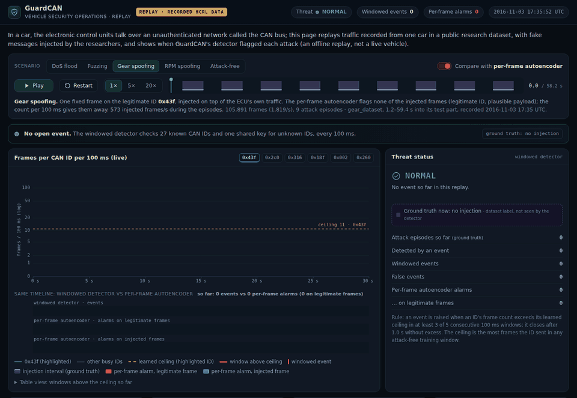

# V-SOC console: replay of recorded HCRL traffic

**Live demo:** <https://casktech-sys.github.io/guardcan/dashboard/> (once GitHub Pages is enabled, see
[below](#publish-it-on-github-pages)). Locally: open `dashboard/index.html` in a browser. No server, no build, no
external scripts or fonts.



A static page (`index.html`) plus one data file (`replay_data.js`, 288 KiB). It replays **recorded** CAN traffic
from the public HCRL Car-Hacking dataset together with the **real output** of GuardCAN's two detectors on it:

- the **windowed detector** (per-ID frame counts in 100 ms windows against a learned ceiling, 3-of-5 rule;
  [`docs/windowed-detection.md`](../docs/windowed-detection.md)), which raises the events, the threat status and the
  alert strip;
- the **per-frame autoencoder** (the time-split model from the main README), shown with the *Compare* toggle: every
  frame whose reconstruction error exceeds its threshold is an alarm.

> **Proof of concept, offline.** This is one vehicle's recorded traffic (HCRL, recorded in November 2016) replayed in
> a browser. It is not connected to a vehicle, and neither detector has run in one. Nothing on the page is simulated
> or random: no frames, events or alarms are generated in the browser.

## Data source and citation

The replayed traffic is from the **HCRL Car-Hacking Dataset**, published by the Hacking and Countermeasure Research
Lab (HCRL), Korea University: <https://ocslab.hksecurity.net/Datasets/car-hacking-dataset>. HCRL recorded it from a
real vehicle through the OBD-II port while injecting DoS, fuzzing, gear-spoofing and RPM-spoofing messages. HCRL
releases it for academic purposes and asks users to cite its paper:

> H. M. Song, J. Woo and H. K. Kim, "In-vehicle network intrusion detection using deep convolutional neural
> network," *Vehicular Communications*, vol. 21, 100198, 2020. doi:[10.1016/j.vehcom.2019.100198](https://doi.org/10.1016/j.vehcom.2019.100198)

**Only aggregated counts derived from the dataset are published** in `replay_data.js`, and on the page:
- frames per CAN ID per 100 ms window;
- the times and frame counts of the injection intervals;
- the times and counts of the detectors' events and alarms;
- the CAN IDs and log times these refer to.

No CAN frames or payloads are included, and the dataset itself is not redistributed. To reproduce anything,
download the dataset from HCRL under its own terms (see [`data/README.md`](../data/README.md)).

Stills: [gear spoofing with the comparison](screenshots/gear_compare.png) ·
[attack-free capture with the comparison](screenshots/attack_free_compare.png) · [DoS](screenshots/dos.png) ·
[full page](screenshots/full_page.png).

## What is replayed

Five stretches of the **time split's test part** (the last 30 % of every recording, which neither detector was
fitted on). The scenarios were picked by a fixed rule in `export_replay.py`, not chosen by hand:

- **Attack scenarios (DoS, fuzzing, gear, RPM).** Each one starts 1.2 s after the end of the episode that comes
  just before the first episode lying wholly in the test part. By then the windowed event of that earlier episode
  has closed. It then takes whole episodes while the replay stays ≤ 60 s, and ends 1.2 s after the last one. In these
  replays HCRL injects a 3.4–5.4 s burst every 6.4–8.4 s, so a scenario holds 7–9 episodes with about 3 s of
  attack-free traffic between them. The attack captures have no long attack-free stretch to show.
- **Attack-free.** The first 90 s of the test part of the separate attack-free capture (`normal_run_data`, recorded
  on another day). Every alarm there is a false alarm.

| scenario | recording | span (into its test part) | length | frames | injected | episodes | windowed events (false) | event latency | per-frame alarms (on legitimate frames) |
|---|---|---|---:|---:|---:|---:|---:|---:|---:|
| DoS | `DoS_dataset` | 1.5–54.5 s | 53.0 s | 61,330 | 12,681 | 7 | 7 (0) | 213–286 ms | 12,957 (276) |
| fuzzing | `Fuzzy_dataset` | 0.3–58.0 s | 57.7 s | 59,131 | 8,123 | 7 | 7 (0) | 212–273 ms | 8,339 (237) |
| gear spoofing | `gear_dataset` | 1.2–59.4 s | 58.2 s | 105,891 | 17,765 | 9 | 9 (0) | 217–295 ms | 119 (119) |
| RPM spoofing | `RPM_dataset` | 3.9–62.6 s | 58.7 s | 122,055 | 22,652 | 9 | 9 (0) | 216–300 ms | 23,078 (426) |
| attack-free | `normal_run_data` | 0.0–90.0 s | 90.0 s | 175,732 | 0 | 0 | 0 (0) | – | 2,352 (2,352) |

In the gear replay all 119 per-frame alarms are on legitimate frames; it flags none of the 17,765 injected ones. On
the attack-free capture it raises 2,352 alarms in 90 s (26 per second), against 0 windowed events.

These replays are short, so they show behaviour, not rates. The headline tiles on the page (358 / 358 episodes,
0 false events in 1,425 s with a 95 % bound of < 7.6 per hour, latency p50 247 ms / p99 300 ms, the per-frame
baseline's 28.3 false alarms per second) are the whole test part, read from
[`bench/hcrl/windowed/metrics.json`](../bench/hcrl/windowed/metrics.json).

## Where every number comes from

`export_replay.py` loads the saved time-split models (`models/hcrl-time/windowed.joblib`, `autoencoder.joblib`),
runs both detectors on the test part exactly as `model/eval_windowed.py` does, and **stops unless** it reproduces the
committed evaluation: the same 360 windowed test events (recording, ID, raise time, windows) and the same per-frame
false-alarm count in every recording as `bench/hcrl/windowed/metrics.json`. Only then does it cut the scenarios.

| on the page | source |
|---|---|
| frames per ID per 100 ms (chart lines) | recorded frames, counted in the detector's own windows (same window edges) |
| ceiling (dashed line) | the learned envelope, `windowed.joblib` (most frames per window in attack-free training windows) |
| injection intervals (violet) | ground-truth labels of the dataset: runs of injected frames ≤ 1 s apart (an *episode*) |
| windowed events, latency, peak | `raise_events` on the test part; latency = raise time − the episode's first injected frame |
| "unknown ID" breakdown (e.g. `0x000`) | the recorded IDs of the frames that filled the shared unknown-ID key during the event |
| per-frame alarms | the autoencoder's flagged test frames, counted per ID and window, split by the dataset label |
| threat status, alert strip, telltale | open windowed events (raised, and not yet 1 s without excess) |
| headline tiles | `bench/hcrl/windowed/metrics.json` (and `cross_day/metrics.json`) |
| capture clock | the HCRL log timestamps (UTC) |

What the page does **not** ship: no frames, no payloads, only counts per ID and window, the IDs behind the
unknown-ID key, and times. Per-frame alarms are drawn per 100 ms window. Within the window each one fired on its
own frame, so the comparison doesn't show the autoencoder's sub-millisecond reaction to DoS, fuzzing and RPM
frames (README: < 1 ms).

Not shown, on purpose:
- **No fleet view.** The "all replays" panel is the same vehicle at five stretches of its test data, labelled so.
  A fleet view would need data from more than one vehicle.
- **No attack-type classifier.** The windowed detector names the ID and the time, not the attack type. The
  "ground truth" column comes from the dataset labels, and the page says so.
- **"What the driver sees"** is a design concept (a generic telltale while an event is open), not something
  built into a vehicle.

## Regenerate the data

Needs the HCRL files in `data/car-hacking/` and the time-split models (see the main README):

```bash
python -m dashboard.export_replay --data data/car-hacking --models models/hcrl-time \
    --metrics bench/hcrl/windowed --out dashboard/replay_data.js
```

Measured on the RTX 4060 laptop: 135–142 s and 3.6–3.8 GiB peak host memory (it loads the full dataset and scores
4.5 M test frames with the autoencoder). Two runs with the same models and data wrote byte-identical files.

## Using the page

- Scenario tabs, play / pause, restart, speed 1× / 5× / 20×, and a scrub bar (click or drag; ←/→ when focused).
- **Compare with per-frame autoencoder** (or key `C`) adds its alarms on the same timeline, a second feed, and
  counters.
- The ID chips choose which CAN ID is highlighted with its ceiling; hover the chart for a window's counts.
- Space toggles play; ←/→ step 1 s.
- **Landing view** (no `#…` in the URL): the gear-spoofing replay at 24 s with the comparison on, paused. The first
  screen therefore already shows four windowed events, an open ALERT and the per-frame alarms next to them. Press Play
  to continue.
- Links can carry the state: `index.html#s=gear&t=24&compare=1` opens the gear replay paused at 24 s with the
  comparison on (`s` = `dos`, `fuzzy`, `gear`, `rpm`, `normal`; `speed` = 1, 5, 20). With `s` but without `t`
  it starts playing.

Dark theme only (an operations console). Works from `file://` (the data is a `<script>`, not a `fetch`), down to
phone width. The design reference was the earlier mockup (`dashboard/mockup.html`, illustrative numbers only).

## Checked

Headless Chromium (Playwright), from `file://` and from a static HTTP server laid out like GitHub Pages
(`/dashboard/`): every scenario was played at 20× to the end and checked:

- the landing view (no `#…`) opens the gear replay at 24 s with the comparison on, 4 events and ALERT, and the
  live chart fits on a 1280×720 screen;
- the plain-language intro and the dataset citation in the footer are present;
- the feed shows exactly the exported events (time, ID, latency, peak);
- every exported event appears in `metrics.json` at the same time into the test part;
- the page's counters equal the exported totals;
- seeking 50 ms before and 10 ms after each event raise time hides and shows it, with ALERT;
- no console errors or failed requests;
- no horizontal scroll at 1280×720, 1366×768, 1024×768 and 390×844;
- playback holds 60 fps.

## Publish it on GitHub Pages

The page is static, so GitHub Pages can serve it straight from the repository:

1. Make sure the branch you publish from contains `dashboard/` (e.g. merge it into the default branch).
2. GitHub Pages needs a **public** repository on the free plan (private repositories need a paid plan). A Pages
   site is publicly readable either way.
3. On GitHub: **Settings → Pages → Build and deployment → Source: "Deploy from a branch"**, pick that branch and
   the **`/ (root)`** folder, **Save**.
4. After the first deployment (a minute or two; see the *Actions* tab), the console is at
   **`https://casktech-sys.github.io/guardcan/dashboard/`**, and the repository README at the site root.

The page needs nothing but `dashboard/index.html` and `dashboard/replay_data.js`. If the Jekyll build of the rest
of the repository ever fails, an empty `.nojekyll` file at the repository root makes Pages serve the files as they
are (the site root then has no index page, but `/dashboard/` still works).

The data file holds aggregated counts *derived* from the HCRL dataset, not the dataset itself (see
[Data source and citation](#data-source-and-citation)). HCRL's page releases the dataset for academic purposes and
names no licence for derived data. Check that a public site fits its terms before you publish.
