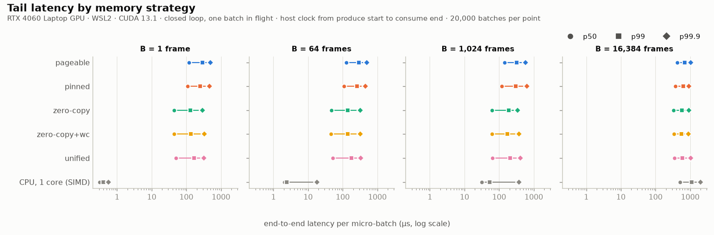
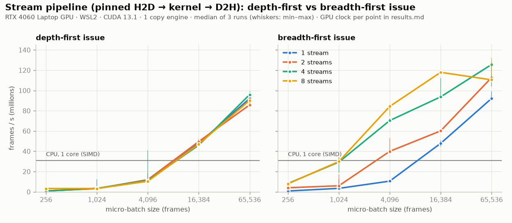
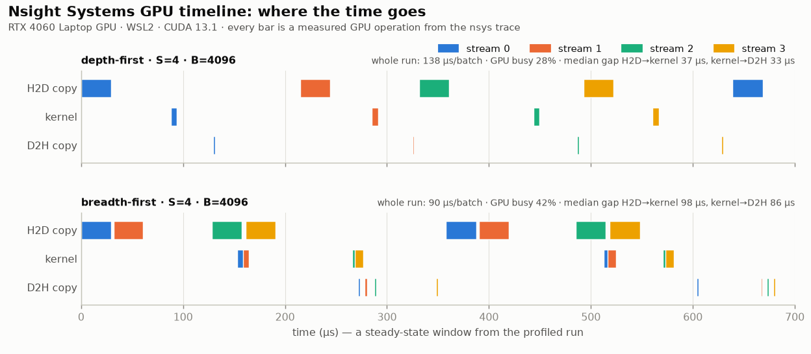

# HPC engine (Week 2)

GuardCAN's Week-1 detector is a tiny autoencoder: 22 → 16 → 8 → 16 → 22 with ReLU, 1,022 parameters, and a
reconstruction error used as the anomaly score. Week 2 runs that model on the GPU with hand-written CUDA (no
TensorRT yet), measures how frames should get to the GPU, and compares the result against a fair CPU baseline.

> **Status: proof-of-concept.** Every number below was measured by the code in `engine/` on one machine
> (RTX 4060 Laptop GPU under WSL2, Intel i7-14650HX) and is reproduced from `bench/hpc/` (`results.md`,
> `summary.json`, the raw `*.json`). Nothing is estimated or hardcoded. The input stream is the **synthetic**
> Car-Hacking-format dataset (`data/make_synthetic.py`) replayed in a loop. This is not a vehicle
> deployment, and WSL2 is not an automotive OS. Read the numbers as "what this design does on this laptop".

---

## 1. Data path

```
CAN frames ──> feature vector (22 × float32 = 88 B/frame) ──> host buffer
                                                                  │  memory strategy (§3): pageable / pinned /
                                                                  │  zero-copy / unified decides HOW bytes cross PCIe
                                                                  ▼
                                    GPU: fused score kernel (scaler + 4 layers + MSE) ──> 4 B/frame score
                                                                  │
host: score > threshold ? ──> security event (V-SOC)  <───────────┘
```

Files:

| file | what it is |
|---|---|
| `model/export_weights.py` | dumps the trained model (PyTorch **or** sklearn backend) + feature scaler + threshold to `models/ae_weights.npz`, self-checks the export with a NumPy forward pass, and writes a reference set (`ae_reference.npz`: test-split features + the Python model's scores) |
| `engine/npz.h` | dependency-free `.npz` reader (zip central directory + `.npy` headers, zip64-aware) |
| `engine/ae_model.h` | the model as a POD struct + **one** `ae::score()` forward pass compiled for both CPU and GPU |
| `engine/ae_kernel.cuh` | the fused kernel, `__constant__` weights, CUDA 12/13 compatibility helpers |
| `engine/infer_streams.cu` | the stream-concurrent batched engine: verify → streams × batch × issue-order sweep → kernel-only ceiling |
| `engine/mem_strategy_bench.cu` | the memory-strategy benchmark (the headline experiment) |
| `engine/cpu_baseline.cpp` | single-thread CPU baseline (scalar reference + an optimized SIMD path) |
| `engine/gpu_monitor.h` | NVML sampler: the GPU clock and P-state recorded next to every measurement |
| `engine/plot_results.py` | charts + tables + `summary.json` from the measured JSON |
| `engine/Makefile`, `run_week2.py` | build / verify / bench / nsys / plot |
| `engine/colab_benchmark.ipynb` | reproducibility fallback on a Colab T4 |

## 2. The kernel and the stream pipeline

**Kernel** (`ae_kernel.cuh`). One thread per frame, 128 frames per block. The block's frames are contiguous
(128 × 22 floats), so they are loaded **coalesced** into shared memory, using `float4` when 16-byte aligned. For
zero-copy, where the "global" pointer is host memory across PCIe, wide contiguous requests are the only way to get
bandwidth. Each thread then runs `ae::score()` entirely in registers. All loops are compile-time sized and fully
unrolled. The weights (≈4.3 KB) live in `__constant__` memory, where every thread of a warp reads the same weight at
the same time: the constant cache's broadcast case. The feature scaler is fused in, and one float per frame is
written back. The kernel is memory-bound: it reads 88 B and writes 4 B per frame for about 2 kFLOP.

**Engine** (`infer_streams.cu`). Frames are processed in micro-batches of B frames. Each batch is
`H2D copy → kernel → D2H copy` on stream `k % S`, using per-stream device buffers and a pinned host ring. Two
**issue orders** are implemented and measured:

- **depth-first:** batch by batch (H2D, kernel, D2H of batch *k*, then batch *k+1*, …).
- **breadth-first (waves):** for a wave of S batches, all S H2Ds, then all S kernels, then all S D2Hs.

With many hardware queues (native Linux, Hyper-Q) both orders overlap copies and kernels. On this machine the GPU
reports **one** copy engine (`asyncEngineCount = 1`), and under WSL2 the Nsight Systems trace shows the work
funnelled through a single in-order path. Each copy→kernel and kernel→copy hand-off costs a cross-engine
synchronisation of tens of microseconds. Depth-first pays that cost on every batch; breadth-first pays it once per
wave. §5 has the measured effect and the trace. (CUDA Graphs were also tried in a scratch prototype, not part of
the committed benchmarks. They did not help on this platform, so they are not in the engine.)

**Verification.** Before benchmarking, the engine scores the held-out test split and compares every score against
the Python model's own `reconstruction_error()` (PyTorch on the GPU, or sklearn). The tolerance is
`|gpu − python| ≤ 1e-6 + 1e-4·|python|`, and the binary exits non-zero on any violation. Every memory strategy is
also checked against the CPU forward pass on its first batch.

## 3. The four memory strategies

The ingest path is identical for every strategy. Per micro-batch: **produce** (the CPU writes the batch's feature
vectors into the strategy's input buffer, standing in for the ingest thread or driver landing frames), **score**
(the kernel), and **consume** (the CPU reads the scores and counts frames over threshold). Only where the buffers
live, and therefore how the bytes cross PCIe, changes:

| strategy | allocation | how bytes move | expected trade-off |
|---|---|---|---|
| **pageable** | `malloc` | `cudaMemcpyAsync`; the driver bounces through its own pinned buffer (an extra CPU copy), and D2H into pageable memory is synchronous | simplest; pays an extra copy and loses async overlap |
| **pinned** | `cudaHostAlloc` (page-locked) | true async DMA on the copy engine | best bulk bandwidth; pays per-copy setup and copy↔kernel hand-offs |
| **zero-copy** | `cudaHostAllocMapped` | **no copies**: the kernel reads frames over PCIe and writes scores straight into host memory | fewest operations, so lowest fixed latency; bandwidth depends on the kernel's access pattern |
| zero-copy + WC | mapped + `cudaHostAllocWriteCombined` input | as zero-copy; the CPU writes the input as streaming writes (it never reads it) | variant of zero-copy |
| **unified** | `cudaMallocManaged`, attached per stream | the driver migrates pages | least code; cost depends on the platform's managed-memory support |
| unified + prefetch | managed + `cudaMemPrefetchAsync` | explicit migration | needs `concurrentManagedAccess = 1`; **not supported on WSL2** (reported as skipped) |

Platform facts the benchmark records (`device` block of every JSON): this GPU under WSL2 reports
`asyncEngineCount = 1` and `concurrentManagedAccess = 0`. The second means managed memory cannot page-fault on
demand while kernels run. The CPU may only touch a managed buffer once the stream it is attached to is idle, which
is why each slot's buffers are attached to their own stream with `cudaStreamAttachMemAsync`.

## 4. Why tail latency (p99 / p99.9) and not the mean

An in-vehicle IDS is a soft-real-time consumer of hard-real-time networks. Three reasons it has to be designed to
the tail:

1. **Rare is frequent at bus rates.** A classical CAN bus at 500 kbit/s carries at most about 3.7–4.5 k frames/s at
   100 % load. That is frame-format arithmetic (111–135 bits per 8-byte frame including worst-case bit stuffing),
   not a measurement. With 64-frame micro-batches that is about 60 batches/s per bus, so a 1-in-1,000 (p99.9) event
   happens every ~16 s on every bus, continuously. The mean hides exactly the batches that miss a deadline.
2. **Detection has a deadline.** The value of detecting a spoofed brake or steering frame is that the event (and the
   V-SOC response) happens before the attack has its effect. A detector that is fast on average but occasionally
   stalls for milliseconds has a worst case that the average does not describe.
3. **Freedom from interference (ISO 26262).** On a shared zonal or central computer the IDS runs next to ASIL
   functions. Its timing, and its consumption of CPU, memory bandwidth and PCIe, must be bounded so it cannot
   starve them. Bounded means characterised at the tail, under load, with the power state known.

Batch size is part of the latency budget. Detection latency is *accumulation* (waiting for B frames to arrive) plus
*processing*. At ~4 k frames/s, a 1,024-frame batch takes about 250 ms just to fill from one bus. On a single bus the
batches must be small, and small batches are where per-operation overheads dominate. Large batches arise when
streams are aggregated: many buses at a gateway or central computer, or fleet replay at the V-SOC.

How latency is measured here:
- **memory strategies:** closed loop, one batch in flight. Host `steady_clock` time from produce start to consume end
  (the true end-to-end latency), split into produce / GPU / consume, plus CUDA-event GPU time.
  20,000 batches per point.
- **stream engine:** per-batch CUDA events on the batch's stream (before H2D → after D2H) in a separate,
  instrumented pass. Throughput is measured in an event-free pass, because recording events costs host time on
  WDDM and measurably lowered throughput. Medians over 3 repetitions; latency samples pooled.
- **interleaving:** every configuration is measured in several blocks (10 latency blocks or 3 throughput reps), and
  each round visits the configurations in a freshly shuffled order (fixed seed). Thermals, background load and
  above all the GPU's power-state history then land on every configuration alike. A first, back-to-back run had
  shown the bias this removes: one strategy's latency was measured at P5 (≈420–915 MHz) while its neighbours ran
  at P0.
- **percentiles** are nearest-rank. The GPU clock and P-state (NVML, every 50 ms) are recorded for every
  configuration. Clocks were **not** locked: they are driver-managed, as a default deployment would be.

## 5. Measured results

All numbers come from `bench/hpc/` (`results.md` has every row with its GPU clock; `summary.json` the derived
figures). Platform: RTX 4060 Laptop GPU (sm_89, 24 SMs, PCIe 4.0 x8), driver 592.82 / CUDA 13.1, WSL2 on Windows,
Intel i7-14650HX. The GPU reports `asyncEngineCount = 1` and `concurrentManagedAccess = 0`.

### 5.1 Correctness

The current model is the PyTorch autoencoder trained on the **HCRL Car-Hacking dataset** (200 epochs, threshold
0.04625; see the README). The GPU engine scored all 4,465,543 frames of its held-out test split with **0 scores out
of tolerance** (max relative difference 3.2 × 10⁻⁵; `bench/hpc/verify.json`). One frame's threshold decision
differs from Python. That frame scores within the comparison tolerance of the threshold: 27 test frames do, the
closest 2.6 × 10⁻⁸ from it. So this is float32 rounding at the decision boundary, not a model mismatch. On the
synthetic test split (20,903 frames) the same export gives 0 out of tolerance and 0 flips.

Before that, the engine was verified against the synthetic-trained 200-epoch model with 0 scores out of tolerance
and 0 flips (max relative difference 7.9 × 10⁻⁶). The two CPU implementations match to the same tolerance. Every
memory strategy's first batch matched the CPU forward pass.

**Which weights the timings used.** The timing runs in `bench/hpc/` used an earlier 30-epoch export of the same
1,022-parameter architecture. That model was undertrained, and Phase 1 now trains for 200 epochs. The engine
passed against those weights too (max relative difference 4.0 × 10⁻⁶). Timing does not depend on the weight values:
the work per frame is fixed and the kernel has no data-dependent branches. This was checked rather than assumed,
because CPUs can slow down on denormal values:

- the CPU baseline with the 200-epoch weights ran at 30.6 M frames/s, against 30.9 M committed;
- the sustained kernel ran at 2.504 G frames/s, against 2.498 G committed;
- the pinned B = 65,536 end-to-end run, alternating the 200-epoch weights with a different (sklearn) weight set,
  gave 94.0 / 98.9 / 97.9 / 95.0 M frames/s, so there is no weight effect.

### 5.2 Headline numbers

| path (one stream of 88-byte feature vectors) | frames/s | vs 1 CPU core (SIMD) |
|---|---:|---:|
| CPU, 1 thread, scalar loop (the kernel's own `ae::score`) | 3.7 M | 0.12× |
| **CPU, 1 thread, SIMD (the baseline)** | **30.9 M** | 1.0× |
| GPU end-to-end, best memory strategy (pinned, B = 65,536; includes the CPU produce/consume work) | 104.0 M | 3.4× |
| GPU engine from a pinned ring (breadth-first, 4 streams, B = 65,536) | 125.6 M | 4.1× |
| GPU kernel only, device-resident, sustained | 2,497.6 M | 80.9× |

The speedups use the optimized single core. Against the scalar loop they would look about 8× larger, which is why
the scalar loop is not the baseline. The kernel-only figure is **2.5 G frames/s at 230 GB/s, ≈90 % of the GPU's
256 GB/s DRAM bandwidth**. With all data already on the GPU, the kernel is memory-bound and close to the hardware
limit.

### 5.3 Memory strategies (the headline experiment)




End-to-end throughput, frames/s (median of 3 interleaved reps; 4 streams × 2 waves in flight):

| strategy | B = 1,024 | B = 4,096 | B = 16,384 | B = 65,536 |
|---|---:|---:|---:|---:|
| pageable | 15.9 M | 38.8 M | 46.2 M | 51.8 M |
| pinned | 25.7 M | 64.5 M | 90.7 M | **104.0 M** |
| zero-copy | **62.9 M** | 77.3 M | 77.7 M | 90.1 M |
| zero-copy + WC | 62.3 M | **83.7 M** | 79.4 M | 90.3 M |
| unified | 29.8 M | 62.0 M | 85.3 M | 91.6 M |
| unified + prefetch | not supported on WSL2 (`concurrentManagedAccess = 0`) | | | |

End-to-end latency per micro-batch, µs (closed loop, 20,000 batches each):

| B | strategy | p50 | p99 | p99.9 | GPU-side p50 (CUDA events) |
|---:|---|---:|---:|---:|---:|
| 1 | pageable | 121 | 294 | 491 | 93.9 |
| 1 | pinned | 110 | 255 | 461 | 79.4 |
| 1 | **zero-copy** | **44.2** | **129** | **292** | 11.3 |
| 1 | unified | 50.3 | 170 | 317 | 12.3 |
| 1,024 | pageable | 143 | 322 | 582 | 108 |
| 1,024 | pinned | 120 | 302 | 627 | 81.1 |
| 1,024 | **zero-copy** | **61.3** | **191** | **343** | 18.4 |
| 1,024 | unified | 65.2 | 211 | 414 | 18.4 |
| 16,384 | pageable | 418 | 702 | 1,047 | 283 |
| 16,384 | pinned | 379 | 626 | 907 | 205 |
| 16,384 | **zero-copy** | **333** | **572** | 912 | 152 |
| 16,384 | unified | 357 | 598 | 1,043 | 172 |

What the measurements show:

1. **Small batches: zero-copy wins clearly.** At B = 1,024 it moves 62.9 M frames/s, 2.4× pinned and 4.0×
   pageable, with half the p50 latency (61 µs vs 120 µs pinned) and a lower p99.9 (343 µs vs 627 µs). There is no
   copy engine in its path, so there are no copy↔kernel hand-offs. Its GPU-side time at B = 1 is 11.3 µs, against
   79.4 µs for pinned, whose time is mostly two cross-engine hand-offs around a tiny transfer.
2. **Bulk: pinned DMA wins.** At B = 65,536, pinned reaches 104.0 M frames/s, ahead of zero-copy and unified
   (~90 M). For big contiguous transfers, the copy engine is more efficient than the kernel pulling data over PCIe.
3. **Pageable is worst everywhere** and plateaus at ~52 M frames/s. The driver's extra staging copy is CPU work on
   the critical path, and D2H into pageable memory is synchronous.
4. **Unified memory works on WSL2 but cannot be tuned.** Prefetch is unavailable here, yet with stream-attached
   buffers it lands between pinned and zero-copy (50 µs p50 at B = 1; 91.6 M frames/s at B = 65,536).
5. **Write-combining** the zero-copy input made no consistent difference (it wins at B = 4,096 and is level
   elsewhere, within run-to-run spread).
6. **The latency floor is the driver, not the GPU.** At B = 1 zero-copy's end-to-end p50 is 44 µs, but the GPU is
   busy for 11 µs of it. The rest is kernel launch and synchronisation through the WSL2 driver stack.

### 5.4 Stream pipeline: issue order, not stream count (a WSL2 effect)





Pinned engine throughput at 4 streams (median of 3 interleaved reps):

| B | depth-first | breadth-first | ratio |
|---:|---:|---:|---:|
| 256 | 0.86 M | 8.2 M | 9.5× |
| 1,024 | 3.4 M | 29.3 M | 8.6× |
| 4,096 | 11.1 M | 70.3 M | 6.3× |
| 16,384 | 46.0 M | 93.7 M | 2.0× |
| 65,536 | 96.0 M | **125.6 M** | 1.3× |

- **More streams do nothing for depth-first.** All four stream counts sit within noise at every batch size, because
  the work is serialised anyway. **Breadth-first** scales from 1 to 4 streams, and to 8 at B ≤ 16,384.
- **The Nsight trace shows why** (`bench/hpc/infer_streams.nsys-rep`, S = 4, B = 4,096). Depth-first: **0 %** of
  kernel time overlaps a copy, the GPU is busy only **28 %** of the time, and on the same stream the median idle gap
  is **36.8 µs** from H2D-end to kernel-start and **32.7 µs** from kernel-end to D2H-start, for 138.5 µs per batch.
  Breadth-first: GPU busy 42 %, 15 % of kernel time overlapping copies, 90.2 µs per batch.
- **This is a WSL2 single-copy-queue effect, not a general CUDA rule.** The GPU exposes one copy engine here
  (`asyncEngineCount = 1`). Under WDDM paravirtualisation the trace shows every stream's work running as one in-order
  sequence, so another stream's H2D does not start while a stream waits on its copy↔kernel hand-off. On native Linux
  (Hyper-Q, independent hardware queues), depth-first multi-stream pipelines normally overlap copies and kernels, and
  the gap between the two orders would be expected to shrink. That was **not measured here**; the Colab T4 notebook
  (native Linux) is the comparison point.
- **Power state amplifies it, and the two effects are separated here.** In the sweep, depth-first at B ≤ 4,096 ran
  mostly at **P8/P5 (210–1,080 MHz)**: its low GPU utilisation let the driver downclock, which slows it further.
  Breadth-first mostly ran at P0. In the Nsight profiling run both orders ran at **2,250 MHz P0**, and breadth-first
  was **1.49×** faster (51.2 vs 34.4 M frames/s) where the sweep shows 6.3×. Both are real effects on this platform.
  The issue order removes hand-off stalls, and a busier GPU stays clocked up.
- **Throughput is bought with latency.** The best configuration (125.6 M frames/s = 11.1 GB/s of input over a link
  whose theoretical rate is 15.75 GB/s) has a per-batch p50 of 1.39 ms and a p99.9 of 1.92 ms.

### 5.5 Tail latency: GPU vs one CPU core

Best GPU strategy (zero-copy, or zero-copy + WC at B = 64) against the SIMD CPU baseline, end-to-end µs:

| B | GPU p50 | GPU p99 | GPU p99.9 | CPU p50 | CPU p99 | CPU p99.9 |
|---:|---:|---:|---:|---:|---:|---:|
| 1 | 44.2 | 129 | 292 | **0.31** | **0.41** | **0.57** |
| 64 | 46.1 | 138 | 320 | **2.0** | **2.4** | **17.8** |
| 1,024 | 61.3 | 191 | **343** | **31.8** | **52.8** | 374 |
| 16,384 | **333** | **572** | **912** | 516 | 1,115 | 1,960 |

**For B ≤ 1,024 one CPU core has the lower typical latency (p50 and p99)**, by two orders of magnitude for single
frames. At B = 1 and 64 it also has the lower p99.9. **At B = 1,024 the GPU already has the lower p99.9** (343 µs vs
374 µs), and **at B = 16,384 the GPU wins** at every percentile, with 2.1× lower p99.9. The CPU's own tail is heavy
too (p99.9 is 12× its p50 at B = 1,024): it reflects OS scheduling on a general-purpose OS under WSL2, not the
algorithm.

## 6. What the numbers mean (and what they do not)

- **For this model, one vehicle's CAN traffic does not need a GPU.** One optimised CPU core scores 30.9 M frames/s,
  orders of magnitude above the ≤ ~4.5 k frames/s that a fully loaded 500 kbit/s bus can carry (§4). At per-bus
  batch sizes it also has lower latency. Claiming the GPU is required to keep up would be false, and this POC does
  not claim it.
- **Where the GPU engine measurably wins:** aggregated streams with large batches (3.4× end-to-end, 4.1× from a
  pinned ring), tail latency at large batches (p99.9 912 µs vs 1,960 µs at B = 16,384), and **compute headroom**.
  The kernel alone sustains 2.5 G frames/s, 81× one core. The end-to-end path sits about 24× below that ceiling
  because of PCIe and host-side overheads, not compute. A heavier detector (e.g. a sequence model over frame
  windows) would use that headroom. That is **not measured here**.
- **What to deploy, on this platform:** zero-copy for latency-sensitive small batches, and pinned memory with
  breadth-first multi-stream issue for bulk (fleet replay, V-SOC forensics). Never depth-first. Keep the GPU busy or
  pin its clocks: the tail depends on the power state as much as on the code.
- **The bytes are the bottleneck.** Each frame sends 88 bytes in to get 4 bytes out. Sending raw CAN frames (~16 B)
  and building features on the GPU would cut PCIe traffic about 5×. That is a next step, not measured.

## 7. Limitations

- **WSL2 is not the target OS.** Its WDDM paravirtualisation drives the serialisation, cross-engine gaps and launch
  overhead measured above. Native Linux, QNX or DRIVE OS on automotive silicon will differ. The Colab notebook gives
  a native-Linux comparison point (T4).
- **Clocks were not locked** (driver-managed; recorded for every row). One machine, one run set; run-to-run spread
  is reported as min–max.
- **Session-to-session variance is larger than that within-run spread.** A later check of pinned at B = 65,536
  measured 94–99 M frames/s, against 104.0 M (range 103.4–104.8 M) in the committed run. Treat differences of about
  ±10 % between runs on different days as noise on this laptop.
- **Input is the synthetic Car-Hacking-format set, replayed.** The MLP has no data-dependent control flow, so timing
  does not depend on content, but no real vehicle traffic was used.
- **The CPU baseline is single-threaded by design** (the requested baseline). A multi-core CPU comparison was not
  measured.
- `unified + prefetch` could not run on WSL2. Its code path compiles under CUDA 12.5 and 13.1 but is unexercised
  until the notebook runs on native Linux.
- The Nsight figures come from a short (2 × 200-batch) profiled run, kept small so the committed `.nsys-rep` stays
  at ~250 KB.

## 8. Reproduce

Toolchain used for the committed results: CUDA toolkit 13.1 (nvcc 13.1.115) and Nsight Systems 2025.5.2 on Ubuntu
24.04 under WSL2, with Windows driver 592.82. On WSL2, install the **WSL-Ubuntu CUDA toolkit** from NVIDIA's
`wsl-ubuntu` repository. The GPU driver comes from Windows, so never install a Linux driver inside WSL. The sources
also build with CUDA 12.x: checked with nvcc 12.5 for `sm_75`, the Colab T4 target.

```bash
# needs an NVIDIA GPU + CUDA toolkit (nvcc on PATH); nsys optional
python run_week1.py                 # train the Week-1 models (PyTorch on the GPU if available)
python run_week2.py --bench         # export -> build -> verify -> benchmark -> nsys -> charts  (~20 min)
python run_week2.py --data data/car-hacking   # verify a model trained on HCRL against its own test frames

# or step by step
python -m model.export_weights --models models --data data/synthetic
make -C engine                      # ARCH=native by default; ARCH=sm_75 for a T4
make -C engine verify
make -C engine bench nsys plot PYTHON=python
engine/build/infer_streams --kernel-only --weights models/ae_weights.npz \
    --ref models/ae_reference.npz --json bench/hpc/kernel_only.json
```

No GPU? Open `engine/colab_benchmark.ipynb` on a Colab T4. It writes to `bench/hpc-colab-t4/` and never overwrites
the RTX 4060 results.
