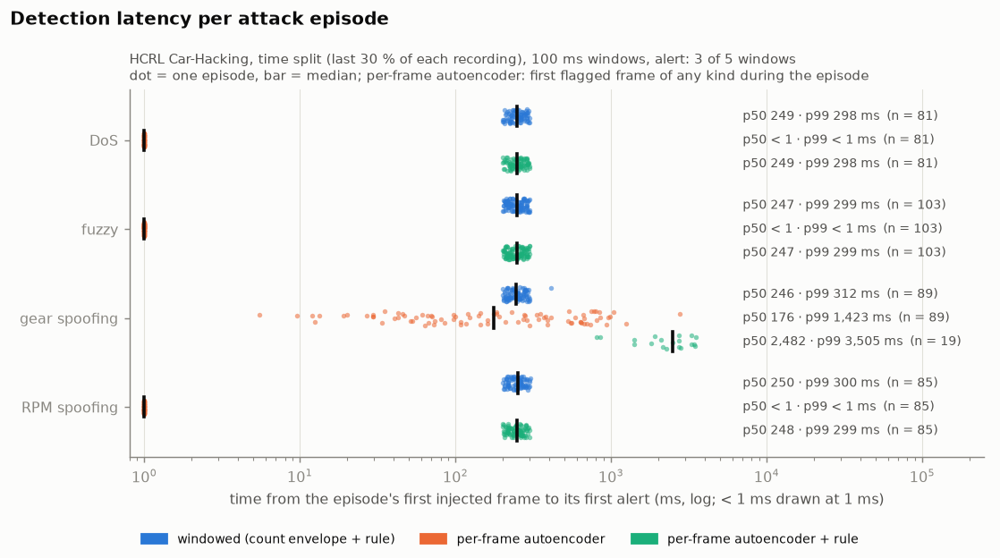
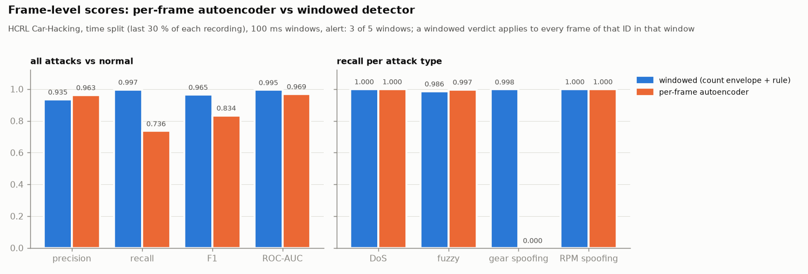
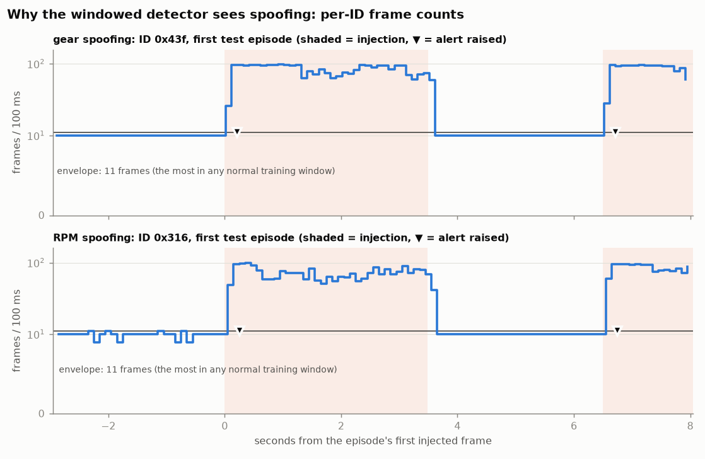
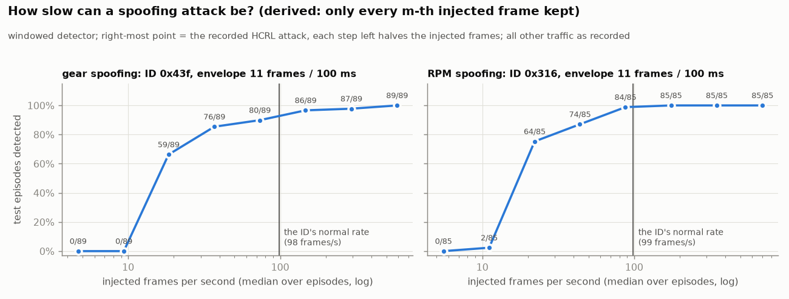

# Windowed, event-level detection

The per-frame autoencoder (README, [HCRL results](../README.md#results-on-the-hcrl-car-hacking-dataset)) has two
weaknesses that a V-SOC cannot work around. It misses gear spoofing completely (recall 0.000 on both splits), and on
the separate attack-free capture it flags 1.45–3.11 % of frames, i.e. **28–61 false alarms per second** (time /
random split). A real IDS raises **events** over time, not a verdict per frame. This document covers the windowed
detector built for that: its design, the alert rule, how every parameter was fixed before the test split was
used, the results on HCRL, and what they do and don't show.

> **Status: proof-of-concept.** One public dataset (HCRL Car-Hacking, one vehicle, recorded in 2016), evaluated
> offline on one machine. Every number below was measured by `model/train_windowed.py` and `model/eval_windowed.py`
> and is in [`bench/hcrl/windowed/metrics.json`](../bench/hcrl/windowed/metrics.json). The injection-rate study
> uses a *derived* attack (recorded attacks with frames removed) and is labelled as such.

---

## 1. What the traffic looks like (measured before choosing anything)

Measured on the HCRL captures (attack-free frames unless stated); the envelope that `train_windowed.py` learns
(`envelope` in `windowed_meta.json`) reproduces the count bound:

- **Periods.** 27 IDs in normal traffic: 17 repeat every 10 ms, 4 every 20 ms, one every 50 ms, three every 100 ms
  and two every 1 s. On the two attack-free captures the same-ID gap of the 10 ms IDs stays within about ±3 ms of
  the period (1st–99th percentile).
- **Counts per 100 ms window are almost constant.** On the separate attack-free capture a 10 ms ID sends 9–11
  frames per window, and in attack-free windows it *never sends more than 11 in any capture*. In the attack
  captures between bursts (and occasionally in `DoS_dataset#1`) the counts dip, down to 0–8, probably frames lost
  by the logger or bus recovery, but they never rise above 11.
- **Attacks.** Every attack capture has 300 bursts of 3.4–6.0 s, separated by ~3.0 s; the first starts within
  1.2 s of the capture's start. The attack captures are therefore 55–64 % attack time. Gear spoofing injects one
  fixed frame on ID `0x43f` at a median 588 frames/s over the test episodes (RPM: `0x316`, 700 frames/s), on top of
  the ID's normal 98 frames/s (10 ms period). Meanwhile the legitimate `0x43f` frames drop from 99 to 67 per second during a burst.
  DoS injects `0x000`, an ID that never occurs in normal traffic; 98 % of the fuzzing frames use IDs that never
  occur either.

## 2. Design

### Window: 100 ms, tumbling, per CAN ID (`ingest/windows.py`)

A count only means something if the window holds at least one period of the ID, so the window must be at least as
long as the longest common CAN period: **100 ms** (typical periods are 10–100 ms). At 100 ms a 10 ms ID sends
~10 frames per window and phase jitter moves that by one. A shorter window holds one or two frames of a 20–100 ms
ID, so a single late frame swings its count by 50–100 %. A longer window delays every decision (it can come no
earlier than the window's end). The two 1 s IDs get 0 or 1 frame per window: enough to see one flooded, not
enough to see one go silent. The window length was not tuned; one length was enough (§4), so there is no second
one.

Windows are tumbling (not sliding), so consecutive windows are independent evidence for the alert rule, and they
tile each segment from its first frame. The last window of a segment can be shorter; it can only hold fewer frames.

### Features: frame count per ID and window

Per window: the number of frames of every ID seen in normal training traffic, plus one shared **unknown-ID** key
for every other ID. Candidates considered and not used:

| candidate | why not (now) |
|---|---|
| inter-arrival mean / std / min in the window | adds nothing over the count on HCRL; the count already separates every attack. Min inter-arrival would see a *single* out-of-phase frame, so it is the natural next feature for low-rate injection (§5.3) |
| rate relative to the learned normal rate | that is what the envelope does, per ID (below) |
| payload change rate / distinct payloads | legitimate `0x43f` frames change payload between 76 and 88 % of consecutive frames, but some 100 ms windows hold one repeated payload; "too few distinct payloads" would itself raise false alarms |
| share of bus traffic | a flood on one ID shows up directly in that ID's count; DoS and fuzzing show up in the unknown-ID key |

### Model: a per-ID upper envelope (`model/windowed.py`)

The simplest thing that could work: for every ID, **hi = the most frames it sent in any attack-free 100 ms
training window**; for the unknown-ID key, hi = 0. A window is anomalous for an ID when its count exceeds hi. The
score log2((count + 1) / (hi + 1)), the excess in octaves, is only used for ranking (frame-level ROC-AUC).

Learned envelope (25,089 attack-free fit windows, 27 known IDs): 11 for the 10 ms IDs, 6 for the 20 ms IDs, 2 for
the 50 ms and 100 ms IDs, 1 for the 1 s IDs, 0 for unknown IDs.

Only the upper side is checked. Injection adds frames; a missing-frames (suspension) check would need a lower
envelope, and the count dips in the attack captures would make that envelope 0 for most IDs. HCRL also has no
suspension attack to validate one against. No autoencoder on window features was added: the envelope already
detects every test episode with no false alarm, so nothing measured justifies the extra complexity.

### Alert rule (`raise_events`)

Per ID: **raise one event at the end of a window when at least K = 3 of the last N = 5 windows (500 ms) of that ID
were anomalous and no event is open on it. While open, anomalous windows extend the event and raise nothing new; it
closes after 1 s (10 windows) without one.**

- K = 3: a late frame moves from window *w* to *w + 1*, so it can push at most one window over the envelope; a
  burst of retransmissions or a phase slip touches one or two. Three windows need at least 200 ms of excess
  traffic, i.e. a sustained source.
- N = 5 (T = 500 ms): tolerates two quiet windows inside an irregular flood. The alert comes 200–400 ms after the
  excess starts, well below the shortest HCRL burst (3.4 s).
- 1 s of quiet ends the event, so an attack that pauses briefly stays one event and the V-SOC isn't sent duplicates.

## 3. Procedure: what was fixed when

- **Split.** The existing **time split**: the last 30 % of every recording is test (`model/common.py`). Within each
  recording's first 70 %, the first 80 % of its time **fits** the envelope (attack-free windows only) and the last
  20 % is **validation**.
- **Fixed before any evaluation:** the window length, the features, K, N and the quiet time (reasoning above), the
  episode definition (injected frames ≤ 1 s apart), the matching rule, and the 1/hour operational bar (§4.3).
- **Fitted on the fit part:** the envelope. Nothing else is fitted.
- **Validation** (before the test split was touched): all 165 validation episodes detected (DoS 43, fuzzy 39,
  gear 41, RPM 42), latency p50 243–256 ms, max 300 ms. **0 false events in 626 s** of attack-free validation
  traffic; 0 of 6,263 attack-free validation windows went above the envelope on any ID. Nothing was changed after
  validation.
- **Scoring.** An episode counts as detected when an alert is raised between its first injected frame and 100 ms
  after its last (the window holding the last injected frame ends at most 100 ms later). Latency = alert time −
  first injected frame; a window's verdict is known when the window ends. Every alert outside an episode is a false
  alarm. An episode that straddles a segment boundary is scored nowhere; in the
  test part two alerts fell into such episodes and count as neither detections nor false alarms.
- **Why not the random split.** The random split holds out scattered frames. Every 100 ms window of every capture
  would contain training and test frames alike, so no window, and no stretch of time for the alert rule, is held
  out. Windowed detection is reported on the time split only; the per-frame baseline's random-split numbers stay
  in the README.

Baselines, on the same test frames: the **per-frame** time-split autoencoder (every flagged frame is an alarm, as in
`bench/hcrl/time_split`) and the **per-frame + rule** variant, where a window is anomalous for an ID when any of its
frames of that ID is flagged and the same K-of-N rule raises events. The second one shows what the alert rule alone
does.

## 4. Results (time split, test part)

### 4.1 Attack episodes detected and latency

| attack | test episodes | windowed | latency p50 / p99 / max | per-frame | per-frame + rule |
|---|---:|---:|---:|---:|---:|
| DoS | 81 | **81** | 249 / 299 / 300 ms | 81 | 81 |
| fuzzy | 103 | **103** | 247 / 299 / 300 ms | 103 | 103 |
| gear spoofing | 89 | **89** | 246 / 312 / 410 ms | 89 (by chance, see below) | 19 |
| RPM spoofing | 85 | **85** | 250 / 300 / 303 ms | 85 | 85 |

The windowed detector raises **exactly one event per episode**, on the attacked key: `0x43f` for gear, `0x316` for
RPM, the unknown-ID key for DoS and fuzzing.

The per-frame model's 89/89 gear "detections" are **chance**. It flags none of the 174,647 injected gear test
frames (recall 0.000), but in the gear capture it flags legitimate frames at 6.0 per second between episodes (1,619 in
271 s), so almost any 3.4 s stretch, attack or not, contains a few flagged frames (median 8 per gear episode). Its first-alarm "latency" on gear (p50 176 ms, p99 1,423 ms)
measures that background rate, not detection. On DoS, fuzzing and RPM it flags the first injected frame (< 1 ms).
With the rule, the per-frame model catches 19 of 89 gear episodes, after a median 2.5 s.




### 4.2 False alarms

| attack-free test traffic | duration | windowed | per-frame | per-frame + rule |
|---|---:|---:|---:|---:|
| separate attack-free capture (`normal_run_data`) | 151.9 s | **0** (95 % bound < 71 /h) | 4,304 = 28.3 /s = 101,982 /h | 39 = 924 /h |
| attack-free tail of the attack CSVs (`DoS_dataset#1`) | 144.6 s | **0** (< 75 /h) | 1,294 = 32,223 /h | 1 = 25 /h |
| attack captures, between episodes | 1,128.1 s | **0** (< 9.6 /h) | 8,656 = 27,622 /h | 250 = 798 /h |
| **all** | **1,424.6 s** | **0 (< 7.6 /h)** | 14,254 = 36,019 /h | 290 = 733 /h |

The bound is a one-sided 95 % Poisson upper limit on the rate (zero events in *t* seconds → 3.0 / *t*).

**Cross-day check** (`--holdout normal_run_data`, [`cross_day/metrics.json`](../bench/hcrl/windowed/cross_day/metrics.json)).
The separate capture was recorded on a different day, and the per-frame model flags 1.45 % of its normal test
frames against 0.28–0.57 % in the other captures (time split). Learning the envelope *without* any of that capture and testing on all 506.4 s of it: **0 false
events (95 % bound < 21 /h)**; pooled with the other attack-free test time, 0 in 1,779.2 s (< 6.1 /h). Detection
is unchanged (81 / 103 / 89 / 85).


### 4.3 What "operational" means here, and what the data can show

A V-SOC triages events from a whole fleet, so the per-vehicle false-event rate is multiplied by the fleet size.
As a **minimum bar for one vehicle I use ≤ 1 false event per hour of driving**, about one a day for a typical car.
Even then, a 10,000-vehicle fleet sends ~10,000 false events a day before correlation; a production system needs one
to two orders of magnitude better, and fleet-level correlation on top. The per-frame detector's 28–61 alarms per
second (100,000–220,000 per hour) is five orders of magnitude above the bar.

The windowed detector raised **no** false event in any attack-free test traffic. That is consistent with the bar,
but it **does not demonstrate it**: HCRL has 0.4 hours of attack-free test time, so the tightest 95 % bound is
< 7.6 /h (< 71 /h on the separate capture alone). Showing ≤ 1 /h at 95 % confidence takes ≥ 3 hours of attack-free
driving with zero false events, and lower rates proportionally more; that data isn't in this dataset.

### 4.4 Frame-level scores (for continuity)

A windowed verdict applies to every frame of that ID in that window.

| | precision | recall | F1 | ROC-AUC | FP rate (normal frames) | gear recall |
|---|---:|---:|---:|---:|---:|---:|
| per-frame autoencoder | 0.963 | 0.736 | 0.834 | 0.9694 | 0.492 % | 0.000 |
| windowed | 0.935 | **0.997** | **0.965** | **0.9946** | 1.207 % | **0.998** |

Per-attack recall (windowed): DoS 1.000, fuzzy 0.986, gear 0.998, RPM 1.000. The windowed frame-level FP rate is
higher, and almost all of it comes from **legitimate frames of the spoofed ID inside an attack window** (2.36 % of
normal frames in the gear capture, 2.65 % in the RPM capture), which a count cannot tell apart from the injected
ones. It is 0 % on both attack-free captures. That is the price of counting: the windowed detector says *which ID*
is under attack and *when*, not which frame is forged.




## 5. What this does and doesn't show

### 5.1 Gear spoofing is detected because it floods the ID, not because of its payload

HCRL's gear attack injects one fixed frame, `0x43f 01 45 60 ff 6b 00 00 00`, ~588 times a second on an ID that
normally sends 100. The detector never reads payloads: the same flood would be caught whatever payload it carried,
a fixed frame or a replay of varied legitimate ones. So the fixed frame does not inflate this result the way it
inflates the supervised classifier (where a three-entry lookup table would score perfectly). But HCRL tests
**one attack style**, a high-rate flood on one ID, and the result says nothing about others:

- **Masquerade at the normal rate.** An attacker who silences the real ECU (e.g. a bus-off attack) and sends the
  ID at its normal period leaves every count unchanged. This detector cannot see that, by construction; it needs
  payload semantics or timing-phase features.
- **Suspension.** An ID that goes silent is not checked (upper envelope only, §2).
- **Low-rate injection.** See §5.2.

### 5.2 How slow can a spoofing attack be? (derived attack)

To measure the detection floor, the gear and RPM test episodes were replayed keeping only every *m*-th injected
frame, all other traffic as recorded (`rate_sensitivity` in `metrics.json`). This is a derived attack, not a
recorded one. False alarms cannot change: only the spoofed ID's counts change, and they only fall.

| injected frames/s (gear) | 588 | 294 | 147 | 74 | 37 | 18.5 | 9.4 | 4.7 |
|---|---:|---:|---:|---:|---:|---:|---:|---:|
| gear episodes detected (of 89) | 89 | 87 | 86 | 80 | 76 | 59 | **0** | 0 |

| injected frames/s (RPM) | 700 | 350 | 175 | 88 | 44 | 22 | 11 | 5.5 |
|---|---:|---:|---:|---:|---:|---:|---:|---:|
| RPM episodes detected (of 85) | 85 | 85 | 85 | 84 | 74 | 64 | **2** | 0 |



Detection falls gradually as the injection rate drops (gear: 89 of 89 episodes at 588 frames/s, 76 at 37/s,
59 at 18.5/s) and stops at about 10 frames/s, +10 % on a 100 frames/s ID. That matches the envelope's arithmetic:
it allows 11 frames per window against a nominal 10, so an injection has to add two or more frames per window, in
three of five windows. An attacker who doubles the rate (+100 frames/s) is caught in 80–86 of 89 gear episodes;
one who adds a frame every 100 ms is not. Some episodes
are missed even at half rate, because frames per episode vary (496–2,827 for gear) and legitimate frames of the
spoofed ID drop during an attack (99 → 67 /s), which offsets part of the injected excess.

### 5.3 Other limits

- **One vehicle, one dataset.** The envelope is that car's traffic. Another vehicle, firmware or driving state
  (e.g. diagnostics sessions that add event-triggered IDs) needs its own envelope, and a never-seen ID raises an
  event on the first window that has one, whether malicious or not.
- **The "between episodes" false-alarm time is post-attack traffic.** HCRL's attack captures have only ~3 s between
  bursts, so 1,128 of the 1,425 attack-free test seconds are recovery gaps, not ordinary driving.
- **Per-ID attribution only for single-ID attacks.** DoS and fuzzing alerts land on the unknown-ID key: correct,
  but they don't name the injected ID.
- **What to add next, if measurements on harder data justify it:** min inter-arrival per ID within the window (one
  out-of-phase frame is enough, so it would catch low-rate injection), a lower envelope for suspension (needs
  attack-free data whose counts don't dip), and payload or phase features for a rate-matched masquerade.

## 6. Running it on the CUDA engine (not done)

The engine (`engine/`) runs one model: a 22-float feature vector in, one reconstruction error out, per frame, with
the weights in `__constant__` memory. It cannot run the windowed detector as is, and it was not changed. What would
be needed:

1. **Input:** (timestamp, CAN ID) per frame, 12 B instead of the 88 B feature vector, so less PCIe traffic.
2. **Lookup tables in constant memory:** a 2,048-entry ID → key table for 11-bit IDs, plus the 28 envelope values.
3. **A histogram kernel:** window index = ⌊(t − t₀) / 100 ms⌋, `atomicAdd` into a per-block shared-memory
   [window × key] table, then a flush to global memory. Windows span micro-batch boundaries, so the open window's
   partial counts must carry from one batch to the next. That makes the pipeline stateful per bus: either one
   in-order stream per bus, or a final reduction keyed by window across streams.
4. **Window close:** compare counts with the envelope (one comparison per key and window).
5. **The alert state machine** (K of N, quiet time) stays on the host: 28 keys, updated once per 100 ms window, not
   per frame.

Whether it is worth it: per bus the detector handles ~2,000 frames/s. The NumPy implementation windows and fits all
14.9 M HCRL frames in 3.1 s on one CPU core (`fit_seconds` in `models/hcrl-time/windowed_meta.json`; not a tuned
benchmark), about 4.8 M frames/s, over 2,000× one bus's frame rate. A GPU path would pay off only when replaying or aggregating many
buses or vehicles at once (fleet back end, offline forensics). There it could share the frame upload with the
per-frame autoencoder and produce both scores in one pass. The Phase 2 timings were not re-run.

## 7. Reproduce

```bash
python -m model.train_windowed --data data/car-hacking --out models/hcrl-time      # fit + validation (~2 min)
python -m model.eval_windowed  --data data/car-hacking --models models/hcrl-time --out bench/hcrl/windowed
# cross-day check: normal_run_data held out entirely
python -m model.train_windowed --data data/car-hacking --holdout normal_run_data --out models/hcrl-crossday
python -m model.eval_windowed  --data data/car-hacking --models models/hcrl-crossday --out bench/hcrl/windowed/cross_day
```

The evaluation uses the time-split autoencoder in `models/hcrl-time` as the per-frame baseline (README, time
split). Each step loads the full dataset (~100 s) and peaks at 3.7 GiB of host memory.
